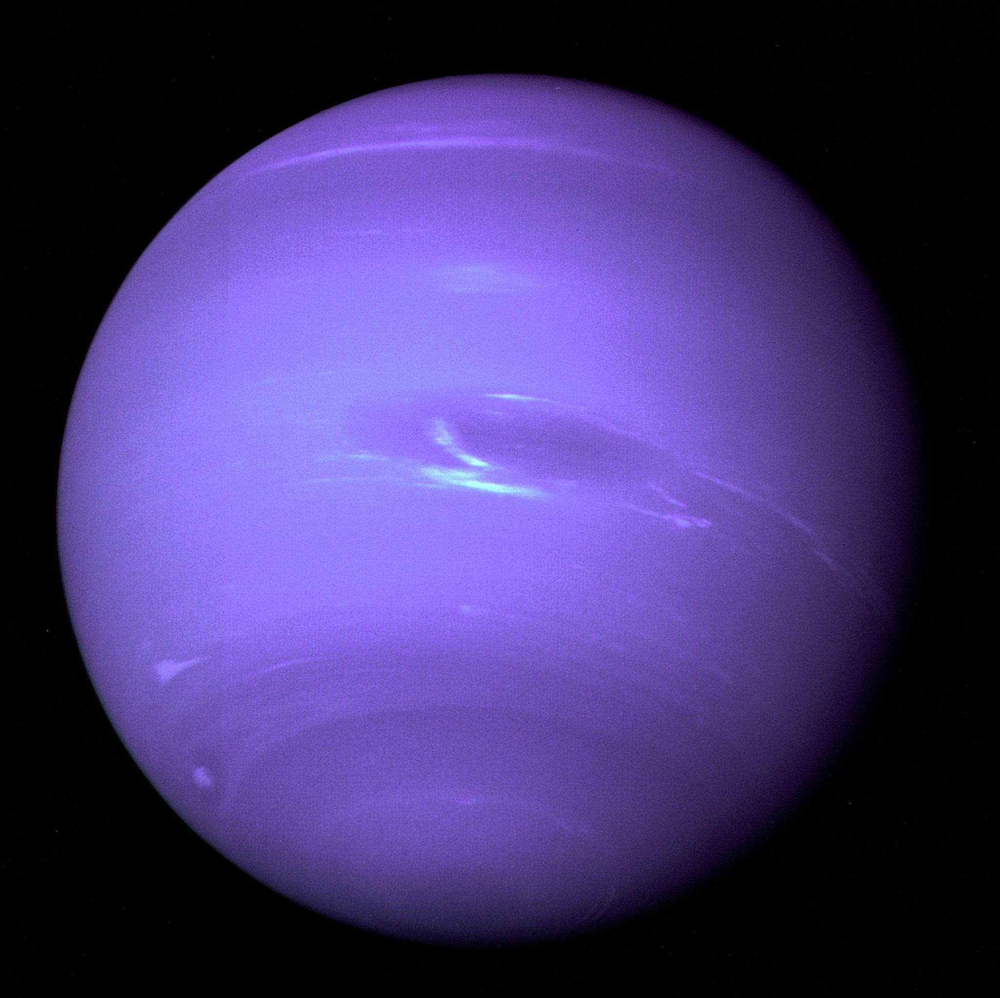
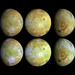

# catmd showcase

A tour of what **catmd** renders. Run it from this directory so image paths resolve:

```sh
catmd showcase.md
catmd --images blocks showcase.md
```

## Inline styles

Text can be **bold**, *italic*, ***both***, ~~struck through~~, or `inline code`.
Styles nest: **bold with *italic* inside**. Links show their destination:
[catmd on GitHub](https://github.com/dnedrow/catmd), or a bare <https://example.com>.

### Lists

- Bullets
  - Nested bullets
  - With **styling**
- Another item

1. Ordered
2. Lists
3. Count up

- [x] Task lists
- [ ] Show their state

### Quotes and alerts

> A block quote keeps its gutter,
> even across wrapped lines.
>
> > And nests.

> [!NOTE]
> Alerts get a colored title.

> [!WARNING]
> So do warnings.

## Code

```rust
fn main() {
    let greeting = "Hello, catmd!";
    println!("{greeting}");
}
```

## Tables

| Planet  | Moons | Notes                  |
|:--------|------:|:----------------------:|
| Jupiter |    95 | Io is volcanic         |
| Neptune |    16 | Triton orbits backward |

---

## Images

A paragraph holding only an image is drawn inline. Wide images are scaled to fit the
terminal width; small ones keep their natural size. Terminals without Kitty or SIXEL
support fall back to half-block cells, and then to a descriptive box.





Images inside quotes and lists stay within the indentation:

> 

A missing image degrades to a placeholder box:


An image within a sentence, like , keeps the plain label.

## Footnotes

Footnotes are numbered and collected at the end.[^1]

[^1]: Like this one.
